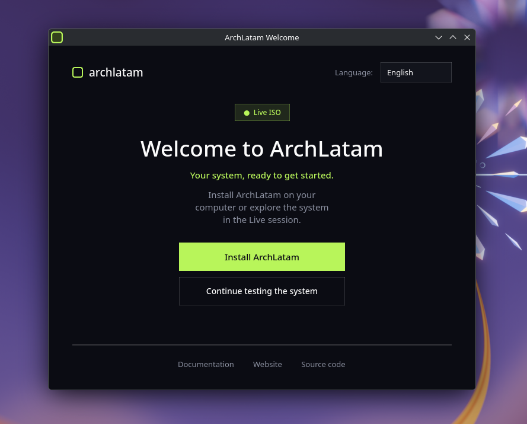

# ArchLatam Welcome — estilo omabox



Versión rediseñada de [archlatam/archlatam-welcome](https://github.com/archlatam/archlatam-welcome) con la estética de [omabox.app](https://omabox.app/):

- Fondo profundo `#0b0c13`
- Acento verde neón `#b8f55a`
- Botones pill, tipografía más limpia
- Badge “ISO Live”
- Selector de idioma recto (inglés por defecto; orden English / Español / Português)
- Misma funcionalidad: idiomas (en/es/pt), lanzar Calamares, enlaces

## Probar sin instalar

```bash
# Opción A — repos de Arch (recomendado)
sudo pacman -S pyside6
python main.py

# Opción B — venv con pip (Arch bloquea pip global por PEP 668)
python -m venv .venv
source .venv/bin/activate
pip install -r requirements.txt
python main.py
```

Para ver el icono propio en la barra de tareas de Plasma sin empaquetar, creá
un `.desktop` local (ejecutá desde el directorio del proyecto, así `$PWD`
apunta a los iconos):

```bash
rm -f ~/.local/share/applications/archlatam-welcome.desktop
mkdir -p ~/.local/share/applications
cat > ~/.local/share/applications/archlatam-welcome.desktop <<EOF
[Desktop Entry]
Type=Application
Name=ArchLatam Welcome
Exec=python3 $PWD/main.py
Icon=$PWD/assets/archlatam-welcome-256.png
Terminal=false
Categories=System;
StartupNotify=true
StartupWMClass=archlatam-welcome
EOF
kbuildsycoca6
```

Con ese archivo presente, la app registra su `app_id` y Plasma usa la marca
verde en el panel. Si no existe, la app lo omite a propósito: sin `.desktop`
el portal responde `App info not found for 'archlatam-welcome'`.

> **Ojo:** un `.desktop` en `~/.local/share/applications/` tiene prioridad sobre
> el que instala el paquete en `/usr/share/applications/`. Después de instalar
> el paquete, borrá el archivo local para que se use `/usr/bin/archlatam-welcome`.

## Icono

La marca vive en `assets/`: `archlatam-welcome.svg` es la fuente y los PNG
(16→512) son el render que consume el tema de iconos. Para regenerarlos:

```bash
for s in 16 22 24 32 48 64 128 256 512; do
  rsvg-convert -w $s -h $s assets/archlatam-welcome.svg \
    -o assets/archlatam-welcome-$s.png
done
```

El diseño es un cuadrado redondeado con borde `#b8f55a` y centro verde musgo
oscuro `#33421c`. El campo y el borde se definen en dos lugares: el SVG y la
constante `ICON_BG` de `main.py` (que usa el fallback dibujado con `QPainter`).

`main.py` busca el icono en este orden: directorio del script → `assets/` →
tema hicolor instalado → dibujo en runtime con `QPainter` (fallback si solo
copiás el `.py`).

## Instalar como paquete (Arch)

Los iconos se quedan en `assets/`. Como `makepkg` no acepta fuentes locales en
subcarpetas, el `PKGBUILD` los copia a `$srcdir` desde `prepare()`; por eso los
PNG/SVG quedan fuera de los `sha256sums`.

1. Actualiza los `sha256sums` del `PKGBUILD` si cambió algún archivo listado en
   `source`:

```bash
makepkg -g
```

2. Construye e instala:

```bash
makepkg -si
```

Esto instala:

- `/usr/bin/archlatam-welcome`
- `/usr/share/applications/archlatam-welcome.desktop`
- `/etc/xdg/autostart/archlatam-welcome.desktop`
- `/usr/share/icons/hicolor/{scalable,16x16,…,512x512}/apps/archlatam-welcome.*`
- `/usr/share/licenses/archlatam-welcome/LICENSE`

## Archivos

| Archivo | Descripción |
|---------|-------------|
| `preview.png` | Captura de la ventana (usada en este README) |
| `main.py` | App rediseñada |
| `assets/archlatam-welcome.svg` | Fuente de la marca (icono) |
| `assets/archlatam-welcome-*.png` | Render 16→512 para el tema hicolor |
| `archlatam-welcome.desktop` | Entrada de menú |
| `archlatam-welcome-autostart.desktop` | Autostart en live |
| `archlatam-welcome.install` | Hook de `gtk-update-icon-cache` |
| `requirements.txt` | Dependencia para probar con pip/venv |
| `PKGBUILD` | Empaquetado para Arch |
| `LICENSE` | GPL-3.0-or-later |

## Personalización rápida

En la parte superior de `main.py`:

```python
BG = "#0b0c13"
ACCENT = "#b8f55a"   # cambia el color de acento aquí
ICON_BG = "#33421c"  # relleno del icono
```

Textos e idiomas: diccionario `TEXT` (en la zona de traducciones).

Enlaces: diccionario `LINKS`.
